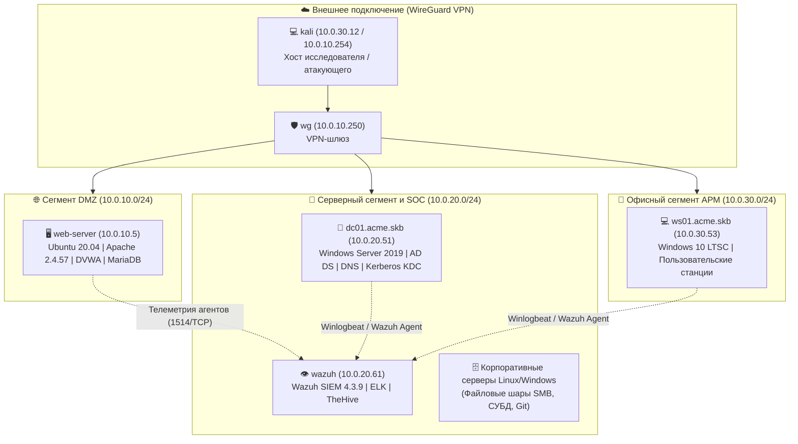

# 🛡️ Практические и дипломные работы по кибербезопасности (Red & Blue Team)
### **Комплексный архив лабораторных практикумов и финального расследования инцидента ИБ на стенде домена `acme.skb` (21 хост, VK Cloud)**

  <b>Программа: «Специалист по кибербезопасности 2.0» (Skillbox, 100% завершена, диплом защищён)</b> 
  Автор: <b>Алексей Жарков</b> &bull; <a href="https://www.linkedin.com/in/aleksei-zharkou/">LinkedIn</a> &bull; <a href="https://t.me/Voobrazhenie_20">Telegram (@Voobrazhenie_20)</a>

---

## 🔗 Флагманские репозитории и интерактивные веб-отчёты

Для удобства просмотра без скачивания `.docx`-файлов ключевые проекты вынесены в отдельные репозитории с живыми веб-дашбордами на **GitHub Pages**:

| Направление | Репозиторий GitHub | Живая веб-версия (GitHub Pages) | Краткое описание |
|:---|:---|:---|:---|
| 👁️ **Blue Team / DFIR (Диплом)** | [`blue-team-incident-investigation`](https://github.com/Voobrazhenie21-lab/blue-team-incident-investigation) | [🌐 **Открыть веб-отчёт**](https://voobrazhenie21-lab.github.io/blue-team-incident-investigation/) | Полное расследование компрометации домена `acme.skb` (Wazuh 4.3.9, 12 тактик MITRE ATT&CK, форензика Linux/Windows) |
| ⚔️ **Red Team / AD Pentest** | [`enterprise-pentest-report`](https://github.com/Voobrazhenie21-lab/enterprise-pentest-report) | [🌐 **Открыть веб-отчёт**](https://voobrazhenie21-lab.github.io/enterprise-pentest-report/) | Отчёт по пентесту инфраструктуры Active Directory по стандартам PTES и NIST SP 800-115 (CVSS v3.1) |
| 🔍 **SOC Automation (Python)** | [`log-sentinel`](https://github.com/Voobrazhenie21-lab/log-sentinel) | [🌐 **Открыть SOC-дашборд**](https://voobrazhenie21-lab.github.io/log-sentinel/) | CLI-движок корреляции логов Linux/Apache/Windows (8 правил детекта: Pass-the-Hash, Kerberoasting, WER, RDP) |
| 🛡️ **DevSecOps SAST (Python)** | [`pipeshield`](https://github.com/Voobrazhenie21-lab/pipeshield) | [🌐 **Открыть дашборд**](https://voobrazhenie21-lab.github.io/pipeshield/) | Статический анализатор секретов (энтропия Шеннона), Dockerfile (CIS) и GitHub Actions с выгрузкой в SARIF 2.1.0 |

---

## 🏗️ Архитектура полигона `acme.skb` (VK Cloud Solutions)

Все практические и дипломные работы выполнялись в распределённой корпоративной инфраструктуре из **21 хоста**, разделённой на три сетевых сегмента:

---

## 📂 Полный реестр отчётов в репозитории

Кликните на название файла в колонке **«Документ отчёта»**, чтобы открыть или скачать соответствующий `.docx`-документ:

### 🛡️ Трек 1: Blue Team, SOC Мониторинг и DFIR-расследование

| № | Тема работы | Что выполнено на практике | Стек и инструменты | Документ отчёта |
|:---|:---|:---|:---|:---|
| **Диплом** | **Финальная работа: Расследование инцидента ИБ (`acme.skb`)** | Полное DFIR-расследование компрометации домена из 12 тактик **MITRE ATT&CK**: обнаружение обфусцированного веб-шелла `backdoor.php` на кастомном Apache 2.4.57 с флагом `-DBIG_SECURITY_HOLE` (`root`), кража `/etc/shadow`, проброс SSH-туннеля (`sshd -R`), брутфорс RDP (`Brute-RDP.py`, 28x `Event ID 4625`, `Rule 60204`), отключение Defender (`5001/5007`), доказательство запуска удалённого эксплойта `CVE-2019-0623.exe` через отчёт падения **`WER AppCrash`**, дамп LSASS через `mimikatz.exe` с проброшенного RDP-диска `\\tsclient`, захват контроллера домена через **Pass-the-Hash (`Rule 92652`)** и доказательство утечки `TOP SECRET!.txt` через `Recent/*.lnk` и `$Recycle.Bin`. | Wazuh SIEM 4.3.9, PowerShell, Linux/Windows Forensics, WER, MITRE ATT&CK | [📄 Финальная работа (.docx)](./Финальная_работа_Расследование_инцидента_ИБ_acme_skb.docx) [🌐 Веб-отчёт](https://voobrazhenie21-lab.github.io/blue-team-incident-investigation/) |
| **1.6** | **Инвентаризация инфраструктуры** | Обнаружение 21 активного хоста в трёх подсетях (`10.0.10.0/24`, `10.0.20.0/24`, `10.0.30.0/24`), полное сканирование всех 65 535 портов, определение версий ОС и сервисов, составление карты сети и архитектуры размещения узлов мониторинга. | Nmap, NSE Scripts, Impacket | [📄 Отчёт 1.6 (.docx)](./Отчёт_практическая_1.6_инвентаризация%20(1).docx) |
| **1.7** | **План внедрения антивирусной защиты и матрица RACI** | Разработка комплексного плана из 7 этапов по внедрению корпоративного средства антивирусной защиты (EPP/EDR) для инфраструктуры на ~200 АРМ, распределение ролей по матрице ответственности **RACI**, построение майнд-карты процесса. | RACI Matrix, FreeMind, Project Management | [📄 Отчёт 1.7 (.docx)](./Практическая_1.7_план_и_RACI.docx) |
| **2.6** | **Актуальные угрозы и развёртывание мониторинга** | Аналитика ландшафта угроз (на базе отчётов Positive Technologies, Group-IB, InfoWatch), разработка плана внедрения SIEM на 21 хост, установка и настройка агентов **Wazuh** (контроль целостности файлов **FIM / whodata**, мониторинг опасных команд, правила `auditd`). | Wazuh 4.3.9, Linux `auditd`, FIM | [📄 Отчёт 2.6 (.docx)](./Отчёт_практическая_2.6_угрозы_и_мониторинг.docx) |
| **3.6** | **Подключение источников событий и политики аудита** | Проектирование источников телеметрии, проверка сетевой связности портов сбора логов, настройка `rsyslog` на Linux и политик расширенного аудита **Windows Advanced Audit Policy (`auditpol`)** для фиксации событий входа (`4624/4625`). | Wazuh, `rsyslog`, `auditpol`, Windows Security Log | [📄 Отчёт 3.6 (.docx)](./Отчёт_практическая_3.6_источники_событий.docx) |
| **5.8** | **Активное реагирование на инциденты (IRP)** | Настройка автоматической блокировки SSH/веб-брутфорса через **Fail2ban**, хантинг и статистический анализ событий `4625` через плейбуки **Jupyter Notebook** (выгрузка из ELK/Winlogbeat), заведение карточек инцидентов и корреляция обсерваблов (IoC) в **TheHive**. | Fail2ban, ELK / Winlogbeat, Jupyter, TheHive | [📄 Отчёт 5.8 (.docx)](./Отчёт_практическая_5.8_реагирование_на_инциденты.docx) |

---

### ⚔️ Трек 2: Red Team, Пентест инфраструктуры и Атаки на Active Directory

| № | Тема работы | Что выполнено на практике | Стек и инструменты | Документ отчёта |
|:---|:---|:---|:---|:---|
| **9.7** | **Комплексное тестирование на проникновение** | Полная цепочка компрометации гибридной сети: сетевая разведка (`Nmap`) $\rightarrow$ перехват и восстановление пароля из NTLM-хеша (`Hashcat` + `rockyou.txt`) $\rightarrow$ доступ по RDP (`xfreerdp`) $\rightarrow$ словарный брутфорс учётных записей $\rightarrow$ извлечение и взлом мастер-пароля базы **KeePass** (`keepass2john` + `John the Ripper`) $\rightarrow$ доступ по SSH к Linux-серверу, дамп `/etc/shadow` (`unshadow`) и захват целевого репозитория. | Nmap, Hashcat, Hydra, xfreerdp, keepass2john, John the Ripper | [📄 Отчёт 9.7 (.docx)](./Отчёт_практическая_работа_9.7_пентест.docx) |
| **10.9** | **Анализ защищённости домена AD (BloodHound CE)** | Сбор телеметрии домена коллектором **SharpHound** (104 объекта AD: пользователи, группы, активные сессии, списки контроля доступа ACL/ACE), развёртывание **BloodHound CE** на Kali Linux (`PostgreSQL` + графовая СУБД `Neo4j`), выявление скрытых путей эскалации привилегий от рядового пользователя до группы `Domain Admins`. | SharpHound, BloodHound CE, Neo4j, PowerShell | [📄 Отчёт 10.9 (.docx)](./Отчёт_практическая_работа_10.9_BloodHound.docx) |
| **11.8** | **Эксплуатация и защита Active Directory** | Практическая реализация классических атак на протоколы NTLM и Kerberos: **Pass-the-Hash** и **Pass-the-Ticket** (`Mimikatz`), перехват и релей аутентификации **NTLM Relay** (`Impacket ntlmrelayx`), атака **Kerberoasting** (`Rubeus` / `GetUserSPNs`, запросы RC4-HMAC `0x17`) с последующим офлайн-перебором хешей. Разработка мер харденинга домена: обязательная подпись SMB (SMB Signing), LAPS, Credential Guard, переход на gMSA и мониторинг `Event ID 4769 / 4624`. | Mimikatz, Impacket (`ntlmrelayx`), Rubeus, John the Ripper | [📄 Отчёт 11.8 (.docx)](./Отчёт_практическая_работа_11.8_атаки_AD.docx) [🌐 PTES Отчёт](https://voobrazhenie21-lab.github.io/enterprise-pentest-report/) |

---

## 🧰 Сводная матрица компетенций

* **Мониторинг и расследование инцидентов (SOC L1/L2 & DFIR):**
  * Работа с **Wazuh SIEM (4.3.9)**, **ELK Stack (Winlogbeat)**, **TheHive**, **Fail2ban**.
  * Глубокий анализ журналов **Windows Event Logs** (`4624` с разбором `Logon Type 2/3/9/10` и `NtLmSsp`, `4625`, `4672`, `4768/4769`, `1102`, `Defender 1116/1117/5001/5007`, `WER 1001`) и **Linux** (`auth.log`, `syslog`, `auditd`, история команд, крон-задачи, веб-логи Apache/Nginx).
  * Хостовая криминалистика: поиск артефактов удалённого ВПО через `WER ReportArchive`, анализ ярлыков `Recent (*.lnk)`, корзины `$Recycle.Bin` с маппингом `SID`, исследование проброшенных RDP-дисков `\\tsclient`.
* **Наступательная безопасность (Red Team & AD Security):**
  * Аудит безопасности Active Directory (`BloodHound CE`, `SharpHound`), эксплуатация `Kerberoasting`, `AS-REP Roasting`, `Pass-the-Hash`, `Pass-the-Ticket`, `SMB NTLM Relay`, злоупотребление правами `ACL (GenericAll / WriteDacl)`.
  * Анализ защищённости веб-приложений (OWASP Top 10: Unrestricted File Upload, SQLi, Command Injection, обфускация веб-шеллов) и построение сетевых туннелей (`SSH Remote Port Forwarding / Pivoting`).
* **Сетевая безопасность и инженерия ИБ:**
  * Стек протоколов L2/L3: `STP (802.1D/w)`, `IEEE 802.1Q VLAN`, `802.1X Port-Based NAC`, `ARP / Gratuitous ARP`, `DHCP (DORA)`, `DNS`, `TCP/IP`, `NAT`, `GRE`, `WireGuard VPN`, `iptables`.
  * Проектирование внедрения корпоративных СЗИ (SIEM, EPP/EDR), матрица ответственности `RACI`, оценка рисков по `CVSS v3.1` и маппинг угроз на матрицу **MITRE ATT&CK**.

---

## ⚠️ Дисклеймер

Все практические и дипломные работы выполнены исключительно в **авторизованной изолированной лабораторной инфраструктуре** (`acme.skb`) в образовательных целях. Применение описанных техник тестирования на проникновение к информационным системам без письменного разрешения правообладателя преследуется по закону (ст. 349–355 УК РБ / ст. 272–274 УК РФ).
